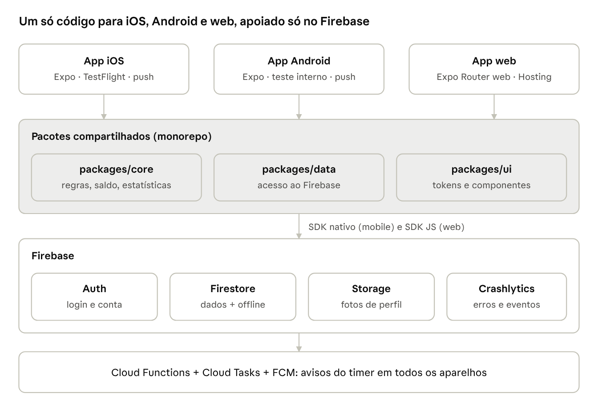
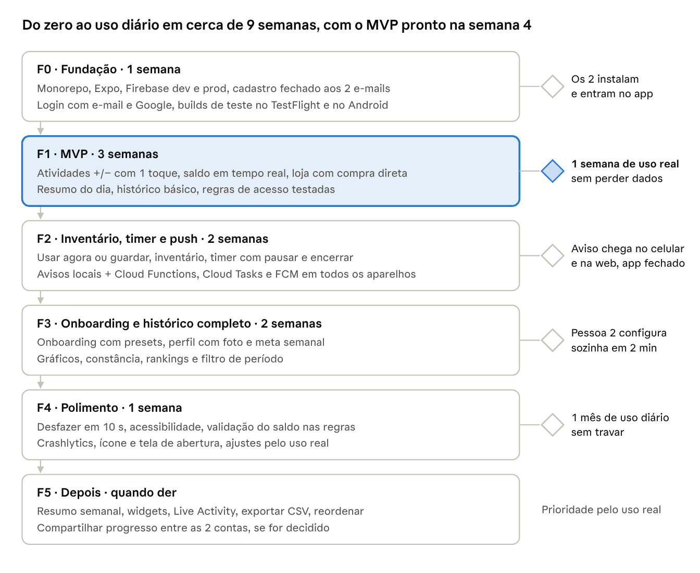

# PRD — Tá pago (Android + web, Firebase)

25/11/2026 · versão editável: [PRD no Claude](https://claude.ai/artifact/AEoSSVLV3GkwZsqFMkm4k6)

## Visão geral

O Tá pago é um app Android e web que transforma comportamento em saldo: atividades boas dão dinheiro fictício, atividades ruins tiram, e o lazer é comprado com esse saldo. Usa só frontend e Firebase, sem backend próprio.

**Problema.** Quem quer equilibrar obrigações e lazer costuma negociar consigo mesmo o tempo todo ("só mais um episódio"), sente culpa ao descansar e não enxerga para onde vai o próprio tempo.

**Proposta.** O usuário define as regras uma vez: quanto vale cada atividade boa, quanto custa cada deslize e quanto custa cada lazer. Depois disso não há mais negociação. Se alguém pergunta "por que você está jogando agora?", a resposta é: **"Tá pago."**

**Em uma frase:** um sistema de economia pessoal em que o esforço vira moeda e o lazer vira recompensa sem culpa.

**Escopo deste PRD:** uso pessoal de **2 pessoas**, cada uma com a sua conta. O app não será publicado nas lojas: o Android é instalado por APK e a web fica num endereço do Firebase Hosting. Não há versão iOS. Isso tira do caminho revisão de loja, métricas de crescimento e boa parte da burocracia de lançamento.

**Superfícies:**

- **App Android**: uso principal no dia a dia — registrar atividades, comprar, rodar o timer, receber notificações.
- **App web**: mesma conta e mesmos dados; bom para cadastrar, revisar o histórico em tela grande e usar no computador.

O protótipo de referência está em [`design/`](../design/README.md) e no [canvas de design](https://claude.ai/artifact/UsGfgCLa6dzL9FXgrBN62e).

## Objetivos e métricas

O sucesso do v1 é as duas pessoas usarem o app quase todo dia por pelo menos um mês, sem perder dados e sem precisar de outra ferramenta.

**Objetivos**

1. Tornar o registro de uma atividade tão rápido quanto desbloquear o celular (1 toque).
2. Fazer o usuário enxergar o equilíbrio entre esforço, lazer e deslizes ao longo das semanas.
3. Tirar a culpa do lazer: comprar, usar no timer e parar quando a notificação avisar.
4. Funcionar igual no celular e na web, com a mesma conta, sem servidor próprio.

**Não objetivos (v1)**

- Dinheiro real, pagamentos ou recompensas físicas.
- Publicação na App Store e no Google Play.
- App nativo para iOS (no iPhone, quem quiser usa a web).
- Crescimento, aquisição de usuários ou monetização.
- Rede social ou ranking público.
- Integração automática com tempo de tela do sistema (Screen Time, Digital Wellbeing).

**Métricas**

| Critério | Como saber | Alvo |
| --- | --- | --- |
| Uso constante | Dias com pelo menos 1 registro por semana, por pessoa | ≥ 5 |
| Loja em uso | Semanas com pelo menos 1 compra, por pessoa | todas |
| Honestidade | Atividades negativas registradas no mês | ≥ 1 por pessoa |
| Timer respeitado | Sessões encerradas no tempo ou antes | a maioria |
| Confiabilidade | Aviso do timer chegou no celular (app fechado) ou na web (aba aberta) | sempre |
| Dados íntegros | Saldo igual no celular e na web | sempre |

Os números saem do próprio Histórico do app; não há Analytics de produto.

## Público e jornadas

São duas pessoas, com contas independentes: cada uma tem as próprias atividades, loja, saldo e histórico.

| Usuário | Aparelhos | O que quer do app |
| --- | --- | --- |
| Pessoa 1 (você, desenvolvedor) | Celular + computador | Equilibrar trabalho, casa e lazer; cortar deslizes de tela |
| Pessoa 2 | Celular (+ web eventualmente) | Mesmo uso, com as próprias regras e preços |

As contas são independentes: nada é compartilhado entre elas. O cadastro é aberto, então qualquer pessoa pode criar uma conta, mas o app é pensado para essas duas.

**Jornadas principais**

1. **Primeiro uso:** cria a conta → onboarding (nome, foto, atividades +/−, loja, notificações) → cai na tela de Atividades já montada.
2. **Dia a dia:** termina uma tarefa → abre o app → toca "+R$ 10" → o saldo sobe. Escorrega no Reels → toca "−R$ 8" → o saldo desce.
3. **Lazer agora:** Loja → "Jogar 1 hora" → "Usar agora" → o timer começa → aviso 5 min antes → aviso no fim.
4. **Lazer depois:** Loja → compra → "Guardar no inventário" → à noite, Inventário → "Começar".
5. **Revisão:** no domingo, abre o Histórico na web → compara ganhos, perdas e tempo de lazer → ajusta preços.

## Conceitos e regras de negócio

Tudo gira em torno de um livro-caixa: cada ação vira um lançamento imutável, e o saldo é a soma deles.

| Conceito | O que é | Efeito no saldo |
| --- | --- | --- |
| Atividade positiva | Ação que o usuário quer fazer mais (lavar a pia, estudar 1 h) | + valor a cada registro |
| Atividade negativa | Deslize que quer reduzir (Reels demais, gritar com alguém) | − valor a cada registro |
| Hábito diário | Atividade positiva com meta de registros no dia (escovar os dentes 3×) | + bônus ao completar a meta |
| Sequência e escalada | Dias seguidos de uma positiva; registros de uma negativa desde o zeramento | mudam o valor do próximo registro |
| Item da loja | Lazer com preço e duração (jogar 1 h, filme 2 h) | − preço na compra |
| Inventário | Itens comprados e ainda não usados | nenhum (já foi pago) |
| Sessão (timer) | Uso de um item, com início, fim, pausa | nenhum |
| Lançamento | Registro imutável de cada evento acima | soma = saldo |

**Regras**

- **R1 — Moeda.** Valores em reais fictícios, guardados como inteiros em centavos. A interface mostra "R$ 18".
- **R2 — O usuário define os preços.** Nome, descrição, tipo (+/−), valor e duração estimada são dele, assim como o hábito, o bônus e o aumento por sequência. Mudar qualquer um deles não altera lançamentos antigos: cada lançamento guarda uma cópia do nome e do valor de fato pago ou cobrado.
- **R3 — Saldo pode ficar negativo** só por atividades negativas. Compras exigem saldo ≥ preço.
- **R4 — Comprar = pagar na hora.** Na compra o app pergunta: "Usar agora" (inicia o timer) ou "Guardar no inventário". As duas debitam o preço.
- **R5 — Um timer por vez.** Com uma sessão ativa, "Usar agora" fica bloqueado; só é possível guardar.
- **R6 — Encerrar antes não devolve dinheiro.** O tempo registrado é o tempo realmente usado.
- **R7 — Pausar** congela o tempo restante; retomar recalcula o fim. **Guardar o resto para depois** encerra a sessão como em R6 (o tempo usado conta, sem reembolso) e devolve ao inventário um item com os minutos inteiros que faltam, para começar de novo quando quiser, em qualquer aparelho.
- **R8 — Desfazer.** Um registro, positivo ou negativo, pode ser desfeito por 10 s (gera um lançamento de estorno, nunca apaga o original). O desfazer devolve a sequência da positiva quando o dia fica sem registro, volta um passo na escalada da negativa (a não ser que o custo tenha sido zerado depois) e estorna o bônus de hábito ou de missão que deixou de valer; batida a meta de novo no dia, o bônus volta a ser pago. Compras não se desfazem.
- **R9 — Tempo de lazer conta no uso**, não na compra. Item guardado não entra nas horas de lazer.
- **R10 — Arquivar em vez de apagar.** Atividades e itens arquivados somem das listas, mas o histórico continua.
- **R11 — Meta semanal** = soma dos ganhos de segunda a domingo, no fuso do usuário: registros positivos e bônus.
- **R12 — Dia limpo** = dia sem nenhuma atividade negativa registrada. **Sequência** (a do Histórico) = dias seguidos com ≥ 1 atividade positiva. Bônus não contam como registro.
- **R13 — Hábito diário** (só positivas). Tem meta de registros por dia (1 a 20) e um bônus em reais. O registro que atinge a meta paga o valor normal e gera **também** o bônus, em lançamento separado. O bônus sai no máximo uma vez por dia em cada atividade; registros além da meta pagam só o valor normal. O progresso zera na virada do dia, no fuso do usuário. O bônus é fixo: não cresce com a sequência. Se o dia já bateu a meta e o bônus ainda não saiu (meta reduzida no meio do dia, ou registros somados de dois aparelhos), o próximo registro o paga.
- **R14 — Sequência positiva.** Cada atividade positiva tem o próprio "aumento por sequência" (pode ser R$ 0) e a própria contagem. Valor do dia = `valor + aumento × dias seguidos anteriores`. Ex.: R$ 100 com aumento de R$ 10 paga 100, 110, 120… Todos os registros do mesmo dia pagam o mesmo valor. Um registro no dia mantém a sequência, mesmo em hábito que não bateu a meta. Um dia inteiro sem registro faz voltar ao valor inicial.
- **R15 — Escalada negativa.** Cada registro soma o valor inicial ao custo: `valor × (registros desde o último zeramento + 1)`. Ex.: R$ 70 custa 70, 140, 210, 280… Vale também para vários registros no mesmo dia. Não zera com o tempo: **só o usuário zera**, na própria atividade.
- **R16 — Teto e cópia.** O valor calculado respeita o teto de R$ 10.000 por lançamento. O lançamento guarda o que foi de fato pago ou cobrado (R2); mudar valor, aumento, meta ou bônus não altera o passado.
- **R17 — Missão do dia.** Uma por dia, com 2 atividades positivas não arquivadas, sorteadas pelo app. Com menos de 2, não há missão. O par não repete o do dia anterior quando existe outra combinação possível. Uma atividade da missão arquivada antes de a missão ser cumprida é trocada por outra; sem substituta, a missão some.
- **R18 — Bônus da missão.** Fixo em R$ 100. A missão é cumprida quando as 2 atividades têm pelo menos 1 registro no dia (em hábitos, 1 registro basta). O bônus é pago uma vez, em lançamento separado, e se soma ao valor das atividades e ao bônus de hábito. Registros feitos no dia antes de a missão ser criada também contam. Missão não cumprida expira na virada do dia, sem penalidade.

**Exemplo no histórico** — escovar os dentes: R$ 50, 3 vezes por dia, bônus de R$ 50, aumento de sequência R$ 0.

| Lançamento | Valor |
| --- | --- |
| Escovar os dentes | + R$ 50 |
| Escovar os dentes | + R$ 50 |
| Escovar os dentes | + R$ 50 |
| **Bônus de hábito completo** · Escovar os dentes (3 de 3 no dia) | + R$ 50 |

## Requisitos funcionais

São 60 requisitos em 13 módulos. P0 = necessário para começar a usar, P1 = antes de as duas pessoas adotarem de vez, P2 = quando der. A coluna Fase liga cada item ao roadmap. Login com Apple saiu do escopo, porque não há app iOS.

| ID | Requisito | Critério de aceite | Prioridade | Fase |
| --- | --- | --- | --- | --- |
| AUTH-01 | Cadastro e login com e-mail e senha | Conta criada no Firebase Auth; sessão mantida ao reabrir o app | P0 | F0 |
| AUTH-02 | Login com Google | Funciona no Android e na web | P0 | F0 |
| AUTH-04 | Recuperar senha | E-mail de redefinição enviado pelo Firebase | P0 | F0 |
| AUTH-05 | Sair da conta; excluir conta (P2) | Sair limpa o cache local e cancela as notificações agendadas no aparelho. Excluir (F5) apaga pelo próprio app todos os dados da conta e o login, com confirmação; precisa de internet | P0 | F0 |
| AUTH-06 | Mesma conta no Android e na web | Dados iguais nos dois em até 2 s com internet | P0 | F1 |
| ONB-01 | Boas-vindas e "como funciona" | 2 telas explicando +, − e loja | P1 | F3 |
| ONB-02 | Nome e foto no onboarding | Nome obrigatório; foto opcional | P1 | F3 |
| ONB-03 | Escolher atividades de uma lista sugerida | Presets + e −, valor ajustável com −/+; ≥ 1 positiva para seguir | P1 | F3 |
| ONB-04 | Montar a loja com presets | ≥ 1 item para seguir | P1 | F3 |
| ONB-05 | Pedir permissão de notificação com contexto | Tela explica antes do pedido do sistema; "Agora não" não bloqueia | P1 | F3 |
| ONB-06 | Refazer configuração pelo Perfil | Não apaga histórico nem saldo | P2 | F5 |
| ACT-01 | Criar atividade (nome, descrição, tipo +/−, valor, duração) | Tipo escolhido antes; rótulos mudam ("Você ganha" / "Você perde") | P0 | F1 |
| ACT-02 | Editar e arquivar atividade | Lançamentos antigos mantêm nome e valor | P0 | F1 |
| ACT-03 | Registrar atividade com 1 toque | Positiva ou negativa, sem confirmação; saldo atualiza na hora, também sem internet | P0 | F1 |
| ACT-04 | Lista separada: "Ganham" e "Custam" | Negativas com visual distinto (não só por cor) | P0 | F1 |
| ACT-05 | Desfazer registro por 10 s | Gera estorno; saldo volta | P1 | F4 |
| ACT-06 | Reordenar atividades | Ordem salva e igual em todos os aparelhos | P2 | F5 |
| ACT-07 | Resumo do dia no topo | Ganhos de hoje, perdas de hoje, quantidade feita | P0 | F1 |
| HAB-01 | Marcar uma atividade positiva como hábito diário | "É um hábito diário?"; se marcado, "Quantas vezes por dia?" (1 a 20) e "Bônus ao completar", os dois obrigatórios | P1 | F6 |
| HAB-02 | Progresso do hábito no cartão | Registros do dia sobre a meta ("2 de 3") e estado "completo" | P1 | F6 |
| HAB-03 | Bônus de hábito completo | Lançamento próprio, identificado como bônus no histórico, com aviso na tela ao ser pago; uma vez por dia em cada atividade | P1 | F6 |
| SEQ-01 | Aumento por dia de sequência | Campo próprio de cada atividade positiva, sugestão inicial R$ 10, aceita R$ 0 | P1 | F6 |
| SEQ-02 | Valor do próximo toque no cartão | O cartão mostra o que o toque vai pagar ou cobrar | P1 | F6 |
| SEQ-03 | Contagens no cartão | Positiva: dias de sequência; negativa: registros desde o zeramento | P1 | F6 |
| SEQ-04 | "Zerar custo" na negativa | Com confirmação; o próximo registro volta ao valor inicial e o histórico não muda | P1 | F6 |
| MIS-01 | Missão diária criada pelo app | 2 positivas sorteadas por conta e data, iguais no Android e na web; não repete o par do dia anterior se houver outro | P1 | F7 |
| MIS-02 | Cartão "Missão do dia" | No topo de Atividades, com as 2 atividades, o que já foi feito e o bônus | P1 | F7 |
| MIS-03 | Bônus da missão | R$ 100 em lançamento próprio, uma vez por dia, com aviso na tela ao ser pago | P1 | F7 |
| MIS-04 | Missão no histórico | Linha "Bônus da missão do dia" com os nomes das atividades | P1 | F7 |
| SHOP-01 | Criar, editar e arquivar item (nome, preço, duração) | Igual a ACT-01/02 | P0 | F1 |
| SHOP-02 | Comprar item | Bloqueado se saldo < preço, mostrando quanto falta | P0 | F1 |
| SHOP-03 | Escolher "Usar agora" ou "Guardar" na compra | Modal com as duas opções; "Usar agora" bloqueado se há timer ativo | P0 | F2 |
| SHOP-04 | Recibo "Tá pago." | Mostra item, duração, valor, saldo restante e status | P1 | F2 |
| INV-01 | Listar itens guardados | Ordem da compra mais recente; data e valor pago | P0 | F2 |
| INV-02 | Começar item guardado | Inicia o timer e tira o item do inventário | P0 | F2 |
| TMR-01 | Timer com contagem regressiva | Sobrevive a fechar o app (calculado por horário de fim, não por contagem local) | P0 | F2 |
| TMR-02 | Pausar e retomar | Fim recalculado; avisos reagendados nos aparelhos | P0 | F2 |
| TMR-03 | Encerrar antes | Registra minutos realmente usados; sem reembolso; avisos cancelados | P0 | F2 |
| TMR-04 | Mini timer visível nas outras abas | Toque leva ao Inventário | P1 | F2 |
| TMR-05 | Timer sincronizado entre aparelhos | Iniciado no celular, aparece na web e vice-versa | P0 | F2 |
| TMR-06 | Guardar o resto para depois | Encerra o uso, conta o tempo usado e devolve ao inventário os minutos que faltam (≥ 1), marcado como "Resto de…" | P1 | F5 |
| NOTIF-01 | Aviso no fim do tempo | Notificação local em todo celular Android que viu a sessão, com o app fechado e sem internet | P0 | F2 |
| NOTIF-02 | Aviso 5 min antes | Só para sessões > 5 min; desliga no Perfil | P1 | F2 |
| NOTIF-03 | Aviso na web | Alerta na página + notificação do navegador, com a aba aberta (sem push com a aba fechada) | P1 | F2 |
| NOTIF-04 | Resumo semanal no domingo | Notificação local no Android que abre o Histórico (ganhos, perdas, lazer e sequência) | P2 | F5 |
| NOTIF-05 | Timer na tela de bloqueio (notificação fixa) | Android: contagem regressiva do sistema, some no fim; pausada mostra quanto falta | P2 | F5 |
| NOTIF-06 | Lembrete diário opcional | Notificação local no Android, na hora escolhida no Perfil; desligado por padrão | P2 | F5 |
| WID-01 | Widget na tela inicial do Android | Saldo, resumo do dia e o timer em andamento; toque abre o app | P2 | F5 |
| HIST-01 | Filtro de período: 7, 30, 90 dias | Todos os blocos respeitam o período | P0 | F3 |
| HIST-02 | Cartões: ganhou, perdeu, gastou, tempo bom, lazer, tempo perdido | Com variação contra o período anterior | P0 | F1 |
| HIST-03 | Divisão do tempo: bom × lazer × ruim | Barra + frase "para cada 1 h de lazer…" | P1 | F3 |
| HIST-04 | Gráfico de saldo no período | Linha diária | P1 | F3 |
| HIST-05 | Horas por semana (8 semanas) | Três barras por semana | P1 | F3 |
| HIST-06 | Mapa de constância (13 semanas) | Sequência, recorde e dias limpos | P1 | F3 |
| HIST-07 | Rankings: tempo por atividade, por lazer, onde perdeu | Ordenados, com contagem | P1 | F3 |
| HIST-08 | Atividade recente | Últimos lançamentos, com paginação | P0 | F1 |
| PROF-01 | Nome, frase e foto | Foto recortada em círculo, reduzida para ~256 px (≤ 150 KB) e salva no Firestore; sem foto, a da conta Google ou as iniciais | P1 | F3 |
| PROF-02 | Meta semanal e preferências de notificação | Salvas na conta, valem em todos os aparelhos | P1 | F3 |
| PROF-03 | Exportar dados (CSV) | Todos os lançamentos do usuário | P2 | F5 |
| PROF-04 | Modo escuro | No Perfil: Sistema (padrão), Claro ou Escuro, por aparelho; sem informação do sistema, escuro; contraste ≥ 4,5:1 nos dois temas | P2 | F5 |

## Requisitos não funcionais

O app precisa responder na hora, funcionar sem internet e proteger os dados de cada usuário só com as regras do Firebase.

| Área | Requisito |
| --- | --- |
| Velocidade | Registrar uma atividade atualiza a tela em < 100 ms (escrita otimista, local primeiro). Abrir o app até a lista de atividades em < 2 s. |
| Offline | Firestore com cache persistente: registrar, comprar e usar o timer funcionam sem internet e sincronizam ao voltar. |
| Consistência | Saldo nunca diverge entre aparelhos: cada lançamento e a atualização do saldo vão na mesma escrita em lote (batch). |
| Segurança | Cada usuário só lê e escreve em `users/{uid}`. Cadastro aberto: qualquer pessoa pode criar conta. |
| Privacidade | Dados só das duas pessoas; nada compartilhado com terceiros; sem Analytics de produto. |
| Acessibilidade | Contraste ≥ 4,5:1, alvos de toque ≥ 44 pt, positivo e negativo diferenciados por sinal e forma, não só por cor. |
| Idioma e formato | pt-BR; moeda e datas pelo `Intl` no fuso do aparelho. |
| Custo | Só o plano **Spark** (gratuito, sem cartão). Nada que exija o Blaze: sem Cloud Functions, Cloud Tasks nem Storage. Ficar dentro das cotas grátis (50 mil leituras e 20 mil escritas por dia no Firestore) com paginação e agregados `daily`. |
| Observabilidade | Crashlytics no Android e uso do Firestore no console do Firebase. |
| Plataformas | Android 8+; Chrome, Safari e Edge atuais na web. Sem app iOS. |

## Arquitetura técnica

Decisão: um monorepo TypeScript com Expo (React Native) gerando Android e web a partir do mesmo código, e o Firebase (plano Spark) como único backend. A lógica de negócio fica num pacote puro, testável e igual nas duas plataformas.



*A imagem está desatualizada: não há app iOS, Storage, Cloud Functions, Cloud Tasks nem FCM. Valem só Android e web, com Auth, Firestore, Hosting e Crashlytics.*

Os dois apps dependem dos mesmos pacotes. Só o acesso ao Firebase muda por plataforma: SDK nativo no Android, SDK JS na web. Não há nenhum código de servidor: os avisos do timer são notificações locais agendadas pelos próprios aparelhos.

| Camada | Escolha | Por quê |
| --- | --- | --- |
| Linguagem | TypeScript estrito | Um idioma em tudo |
| Mobile | Expo (SDK atual) + Expo Router, builds com EAS | Só Android; instalação por APK |
| Web | Expo Router web (react-native-web), publicado no Firebase Hosting | Reaproveita telas e lógica; layout com menu lateral no desktop |
| Firebase no Android | React Native Firebase (Auth, Firestore, Crashlytics) via config plugins | Cache offline persistente nativo |
| Firebase na web | Firebase JS SDK modular, `persistentLocalCache` (IndexedDB) | Offline no navegador |
| Backend | Nenhum código de servidor; só Auth, Firestore, regras e Hosting no plano Spark | Grátis e sem cartão |
| Estado | Listeners do Firestore + Zustand | O Firestore já entrega dados em tempo real e escrita otimista |
| Formulários e validação | React Hook Form + Zod | Os mesmos esquemas validam formulários e documentos |
| Gráficos | Desenho próprio com react-native-svg | Mesmo componente no Android e na web; uma linha e algumas barras não pedem biblioteca de gráficos |
| Notificações | `expo-notifications` (locais no Android) + Notification API do navegador (web, aba aberta) | Funciona offline e sem servidor (ver Timer e notificações) |
| Monorepo | pnpm workspaces + Turborepo | Cache de build e tarefas por pacote |
| Testes | Vitest (core), Emulator Suite + `@firebase/rules-unit-testing` (regras) | As regras são o backend; telas testadas à mão pelos 2 usuários |
| CI/CD | GitHub Actions; EAS Build; `firebase deploy` para Hosting e regras | Um push na main publica a web e as regras |
| Ambientes | Um projeto só, `tapago` (Spark), + Emulator Suite local para os testes | App pequeno, 2 usuários: um segundo ambiente não se paga |

**Por que não React + Vite na web.** Como o Android precisa de React Native de qualquer jeito, Expo na web permite escrever cada tela uma vez. Com React + Vite, cada tela seria feita duas vezes (React Native e React DOM), compartilhando só `packages/core` e `packages/data`. Vite só compensaria se o app fosse só web ou se o painel web crescesse muito além do app.

**Estrutura de pastas**

```
tapago/
  apps/
    app/            # Expo Router: Android e web
  packages/
    core/           # tipos, regras de negócio, cálculos do histórico (sem React)
    data/           # repositórios: activities, shop, entries, session, profile
    ui/             # tokens de design, componentes base
  firebase/
    firestore.rules
    firestore.indexes.json
    tests/          # testes das regras no emulador
```

## Modelo de dados e regras

Todos os dados de um usuário ficam sob `users/{uid}` no Firestore. O saldo é um campo do documento do usuário, sempre atualizado na mesma escrita em lote que cria o lançamento. Valores em centavos (inteiros), datas como `Timestamp`.

| Caminho | Campos principais | Observação |
| --- | --- | --- |
| `users/{uid}` | `name`, `bio`, `photoURL` (da conta Google, se houver), `balance`, `weeklyGoal`, `timezone`, `notif {end, warn5, weekly, daily?, dailyHour?}`, `onboardingDone`, `deleting?` (exclusão em andamento), `createdAt` | Um por conta |
| `users/{uid}/activities/{id}` | `name`, `description`, `kind` (`positive` \| `negative`), `value`, `minutes`, `order`, `archived`, `createdAt`; positivas: `habit? {target, bonus}`, `streakStep`, `streak? {days, lastDay}`; negativas: `penaltyCount` | Atividades +/−. Campo ausente vale como sem hábito, aumento R$ 0 e contagem zero |
| `users/{uid}/shopItems/{id}` | `name`, `value`, `minutes`, `order`, `archived`, `createdAt` | Loja |
| `users/{uid}/entries/{id}` | `type` (`earn` \| `loss` \| `purchase` \| `use` \| `reversal` \| `bonus`), `refId`, `name`, `value`, `minutes`, `at`, `deviceId`; em `reversal`: `reverses` e `reversedType`; em `earn` e `loss`: `base` (valor inicial) e `level` (dia da sequência ou número do registro desde o zeramento); em `bonus`: `source` (`habit` \| `mission`), no de hábito `target` e no de missão `activities` (id e nome das 2) | Livro-caixa, só criação. O bônus tem `minutes = 0`; o de hábito tem o id `habit_{activityId}_{AAAA-MM-DD}` e o de missão, `mission_{AAAA-MM-DD}` (com `_1`, `_2`… quando pago de novo depois de estornado). O estorno tem o id `undo_{lançamento}` |
| `users/{uid}/inventory/{id}` | `shopItemId`, `name`, `value`, `minutes`, `purchaseEntryId`, `purchasedAt`, `leftFrom?` (só no resto guardado: a duração original) | Apagado ao começar o uso |
| `users/{uid}/state/session` | `id`, `status` (`running` \| `paused`), `itemName`, `totalMs`, `startedAt`, `endsAt`, `remainingMs`, `useEntryId`, `originDevice` | No máximo 1 sessão (R5); o `id` evita avisos duplicados no mesmo aparelho |
| `users/{uid}/daily/{AAAA-MM-DD}` | `date`, `earned`, `lost`, `spent`, `posMin`, `negMin`, `leisureMin`, `posCount`, `negCount`, `buyCount`, `counts` (registros por atividade), `bonuses` (bônus de hábito pagos por atividade), `undone` (bônus de hábito estornados por atividade) | Agregado diário, alimenta o Histórico. O bônus soma em `earned`, sem contar registro nem tempo |
| `users/{uid}/missions/{AAAA-MM-DD}` | `date`, `activities` (2 × `{id, name}`), `bonus`, `createdAt`, `completedAt?`, `reversals?` (estornos do bônus) | Missão do dia (R17). A primeira gravada vale para todos os aparelhos; nunca é apagada |
| `users/{uid}/avatar/current` | `data` (JPEG em base64, ≤ 150 KB), `updatedAt` | Foto de perfil, em documento separado para não pesar nas leituras do usuário |

**Como cada ação escreve (um `writeBatch` por ação)**

- **Registrar atividade:** cria `entries` (`earn` ou `loss`, com o valor calculado por R14 ou R15) + `balance ± value` + incremento em `daily` + `streak` (positiva) ou `penaltyCount + 1` (negativa) na atividade.
- **Pagar o bônus de hábito:** lote próprio, depois do registro: cria `entries/habit_{activityId}_{dia}` (`bonus`) + `balance + bônus` + `earned` e `bonuses` em `daily`. Se o dia já foi pago, o servidor recusa só este lote.
- **Criar a missão do dia:** o app sorteia o par a partir de `uid` + data e grava `missions/{dia}` se ele ainda não existe, separado dos registros. Se outro aparelho gravou antes, o servidor recusa e vale o que está lá.
- **Pagar o bônus da missão:** lote próprio: cria `entries/mission_{dia}` (`bonus`) + `balance + 10.000` + `earned` em `daily` + `completedAt` na missão. Se já foi pago, o servidor recusa só este lote.
- **Zerar o custo de uma negativa:** `penaltyCount = 0`; o livro-caixa não muda.
- **Comprar e guardar:** cria `entries` (`purchase`) + `balance − value` + cria `inventory`.
- **Comprar e usar agora / começar do inventário:** cria `entries` (`use`) + grava `state/session` (+ `purchase` e saldo, se for compra).
- **Encerrar sessão:** atualiza `minutes` do lançamento `use` para o tempo real + apaga `state/session` + `leisureMin` em `daily`.
- **Desfazer:** cria `entries/undo_{id}` (`reversal`, com o mesmo valor, que conta ao contrário) + corrige saldo e `daily` + `streak` ou `penaltyCount` na atividade. Cada bônus estornado vai em um lote próprio; o da missão também apaga `completedAt` e soma 1 em `reversals`.
- **Conferir o saldo:** pelo Perfil, o app soma todos os lançamentos e, se o saldo divergir, corrige a diferença com a confirmação do usuário.

**Regras de segurança (resumo)**

- Leitura e escrita só quando `request.auth.uid == uid`.
- `entries` aceita só `create`; `update` apenas no campo `minutes` de lançamentos `use`; nunca `delete`.
- Ao criar um lançamento, a regra confere com `getAfter()` que o saldo do usuário mudou exatamente pelo valor do lançamento (por isso cada lote tem um só lançamento que mexe no saldo), e que `value` confere com a atividade ou o item referenciado (`get()` em `refId`): nas atividades, o valor calculado por R14 e R15; nos bônus, o do hábito ou o da missão, com os registros do dia que o justificam; no estorno, o do lançamento desfeito.
- O documento do usuário aceita mudar o saldo sem lançamento: é o que a conferência do saldo usa.
- `purchase` só é aceito se o saldo depois da compra for ≥ 0 (R3).
- Campos validados por tipo e faixa: `value` inteiro entre 1 e 1.000.000 centavos, `minutes` entre 1 e 1.440 (0 no bônus), `name` com 1–60 caracteres, meta do hábito entre 1 e 20.
- O bônus só é aceito com os campos dele e com o id fixo do dia: gravar o mesmo id de novo é alterar um lançamento, o que é negado.
- A missão tem sempre bônus de R$ 100 e nunca é apagada: só se troca o par enquanto não foi cumprida, ou se grava `completedAt` junto com o lançamento do bônus. O bônus de missão precisa repetir as atividades da missão.
- `avatar/current` só para o próprio usuário, com `data` limitado a ~200 mil caracteres.

As regras completas estão em [`firestore.rules`](../firebase/firestore.rules). Com dinheiro fictício, elas protegem sobretudo contra erro de programação, não contra ataque; o essencial é o acesso só ao próprio `uid`, que mantém os dados isolados mesmo com o cadastro aberto.

## Timer e notificações

O timer é guardado como horário de fim, não como contagem, então o tempo restante continua certo mesmo com o app fechado. Como o projeto fica no plano Spark, não há servidor para mandar push: **todos os avisos são notificações locais**, agendadas pelos próprios aparelhos.

**Como funciona**

1. Ao começar uma sessão, o app grava `state/session` com um `id` novo, `endsAt = agora + duração` e `originDevice`.
2. Todo celular Android que recebe a sessão (o que iniciou, na hora; os outros, quando o app abre ou o listener recebe a mudança) agenda duas notificações locais (`expo-notifications`): "Faltam 5 minutos" em `endsAt − 5 min` e "Tempo esgotado" em `endsAt`. O `id` da sessão evita duplicar.
3. Pausar, retomar ou encerrar regrava a sessão; cada aparelho que vê a mudança cancela e reagenda os seus avisos.
4. Na web, com a aba aberta, a página mostra o alerta e dispara uma notificação do navegador na hora certa. Com a aba fechada não há aviso, e a tela do timer na web diz isso.
5. A tela calcula `restante = endsAt − agora` a cada segundo. Se o app abrir depois do fim sem ter encerrado, ele fecha a sessão com a duração completa.

| Situação | Android | Web |
| --- | --- | --- |
| App aberto | Contagem na tela + aviso dentro do app | Contagem na tela + aviso dentro da página + notificação do navegador |
| App ou aba fechados | Notificação local (se o app viu a sessão) | Sem aviso |
| Sem internet | Notificação local já agendada continua valendo | Aviso só com a aba aberta |
| Sessão começada em outro aparelho | Avisa se o app foi aberto pelo menos uma vez depois do início | Avisa se a aba estiver aberta |
| Tela de bloqueio | Notificação fixa — fase F5 | — |

**Limitação aceita (F4).** Como o servidor confere o preço, um registro ou uma compra feitos sem internet são recusados se, antes de sincronizar, outro aparelho mudar o valor da atividade ou do item, zerar o custo de uma negativa que ficaria acima do próximo nível, ou gastar o saldo da compra. O app avisa e desfaz a mudança local.

**Limitação aceita (F6).** Dois aparelhos sem internet podem pagar ou cobrar o mesmo nível de sequência ou de escalada, e o que sincronizar por último define a sequência salva. O bônus de hábito e o da missão não se repetem.

**Limitação aceita.** Se o timer começar na web e o celular não abrir o app depois disso, o celular não avisa. Para quem usa o timer principalmente no celular, isso não muda nada. Se um dia for preciso aviso entre aparelhos com tudo fechado, a solução é o plano Blaze com Cloud Functions, Cloud Tasks e FCM.

**Custo.** Zero: tudo dentro do plano Spark, sem cartão.

## Roadmap de implementação

Seis fases levam do zero ao uso diário em cerca de 9 semanas, com o MVP usado pelas duas pessoas a partir da semana 4. As durações são estimativas para 1 desenvolvedor em tempo integral com ajuda de IA; cada fase só termina quando o seu marco é cumprido. Sem lojas nem métricas de crescimento, a antiga fase de lançamento virou uma semana de polimento. A F6 (hábitos diários e sequências) e a F7 (missões diárias) entraram depois, levam cerca de 1 semana cada e rodam antes da F4.

O passo a passo de execução, com as tarefas de cada fase e o que precisa de ação humana, está em [`ROADMAP.md`](ROADMAP.md).



*A imagem ainda cita TestFlight, Firebase dev e prod, cadastro fechado aos 2 e-mails, Cloud Functions, Cloud Tasks, FCM e Live Activity. Isso saiu do escopo; vale a tabela abaixo.*

O MVP (F1) vem antes do timer de propósito: o livro-caixa precisa estar sólido antes de entrar sessão e notificação.

**Épicos por fase**

| Fase | Épico | Entregas | Requisitos | Depende de |
| --- | --- | --- | --- | --- |
| F0 | Base do projeto | Monorepo pnpm + Turborepo, app Expo com Expo Router, lint, CI no GitHub Actions | — | — |
| F0 | Firebase | Projeto único `tapago` (Spark) + emulador local, regras fechadas por `uid` | — | Base do projeto |
| F0 | Autenticação | Entrar, criar conta, esqueci a senha, Google, sair; cadastro aberto | AUTH-01, 02, 04, 05 | Firebase |
| F0 | Distribuição privada | EAS Build gerando APK para Android, Hosting para a web | — | Base do projeto |
| F0 | Design system | Tokens (cores, tipografia, espaçamento), botão, cartão, campo, abas | — | Base do projeto |
| F1 | Livro-caixa | `packages/core` com tipos, cálculo de saldo e estatísticas; `writeBatch` por ação; agregados `daily` | AUTH-06, HIST-02 | Autenticação |
| F1 | Atividades | Criar, editar, arquivar, registrar com 1 toque, listas + e −, resumo do dia | ACT-01 a 04, ACT-07 | Livro-caixa |
| F1 | Loja | Criar, editar, arquivar itens; compra direta com bloqueio por saldo | SHOP-01, 02 | Livro-caixa |
| F1 | Histórico básico | Cartões do período e atividade recente paginada | HIST-02, 08 | Livro-caixa |
| F2 | Inventário | Modal "usar agora / guardar", lista de guardados, recibo | SHOP-03, 04, INV-01, 02 | Loja |
| F2 | Timer | Sessão por `endsAt`, pausar, retomar, encerrar, mini timer, sincronização entre aparelhos | TMR-01 a 05 | Inventário |
| F2 | Avisos no Android | Agendar fim e 5 min antes em todo celular que vê a sessão; reagendar quando ela muda | NOTIF-01, 02 | Timer |
| F2 | Avisos na web | Alerta na página e notificação do navegador com a aba aberta | NOTIF-03 | Timer |
| F3 | Onboarding | Telas com presets + e −, loja, permissão de notificação com contexto | ONB-01 a 05 | Atividades, Loja |
| F3 | Perfil | Nome, frase, foto reduzida no Firestore, meta semanal, preferências | PROF-01, 02 | Autenticação |
| F3 | Histórico completo | Filtro de período, divisão do tempo, gráficos, constância, rankings; painel na web | HIST-01, 03 a 07 | Histórico básico |
| F6 | Hábitos e sequências | Hábito diário com bônus, positivas que sobem com a sequência, negativas que encarecem, zerar custo | HAB-01 a 03, SEQ-01 a 04 | Atividades |
| F7 | Missões diárias | Missão sorteada por dia, cartão e bônus pago uma vez | MIS-01 a 04 | Hábitos e sequências |
| F4 | Polimento | Desfazer 10 s, acessibilidade, validação de saldo nas regras, Crashlytics, ícone, ajustes pelo uso | ACT-05 | Todas as anteriores |
| F5 | Extras | Resumo semanal, widget e notificação fixa do timer no Android, reordenar, refazer onboarding, exportar CSV, excluir conta | NOTIF-04, 05, ACT-06, ONB-06, PROF-03 | Uso diário |

## Riscos e decisões

O maior risco é as duas pessoas pararem de registrar; o técnico é a confiabilidade das notificações locais com o app fechado.

| Risco | Impacto | Mitigação |
| --- | --- | --- |
| Esquecer de registrar e abandonar | Alto | Registro em 1 toque, lembrete diário opcional (P2), widget na tela inicial (P2) |
| Não registrar os deslizes | Médio | Tom sem julgamento, "dias limpos" como recompensa |
| Preços mal calibrados | Médio | Presets no onboarding; revisar preços juntos após a 1ª semana |
| Aviso atrasado com o app Android fechado | Médio | Economia de bateria de alguns fabricantes atrasa notificações; usar alarme exato quando permitido e orientar a tirar o app da otimização de bateria |
| Sem aviso entre aparelhos com tudo fechado (Spark) | Baixo | Limitação aceita; o celular avisa se o app foi aberto depois do início; a web avisa com a aba aberta |
| Estourar as cotas grátis do Spark | Baixo | Histórico lido de `daily`, lançamentos paginados, listeners estáveis; conferir o uso no console na F4 |
| Teste estragar dados reais (projeto único) | Médio | Testes automatizados só no Emulator Suite; nunca apagar dados no projeto real |
| Cadastro aberto atrai contas desconhecidas | Baixo | Dados isolados por `uid`; custo desprezível; dá para fechar o cadastro no Auth se precisar |
| Erro de programação corrompe o saldo | Médio | Lançamentos imutáveis e saldo recalculável a partir deles; testes do `packages/core` |

**Decisões tomadas**

- [x] Contas **independentes**; nada compartilhado entre elas.
- [x] Nome do produto: **Tá pago**.
- [x] Nome da aba: **Atividades**.
- [x] Registrar atividade negativa é **igual à positiva**: 1 toque, sem confirmação; o erro se corrige com o desfazer de 10 s.
- [x] **Sem iOS**: só Android (APK) e web.
- [x] Web com **Expo** (mesmo código do Android).
- [x] **Um projeto Firebase só** (`tapago`), sem separar dev e prod.
- [x] **Só o plano Spark**, sem cartão: sem Cloud Functions, Cloud Tasks, Storage nem push por servidor.
- [x] **Cadastro aberto** a qualquer pessoa.

**Próximos passos**

1. Criar o projeto Firebase `tapago` no plano Spark (ver a aba de intervenção humana do [`ROADMAP.md`](ROADMAP.md)).
2. Começar a F0 com o monorepo, a autenticação e o primeiro APK instalado nos dois celulares.
